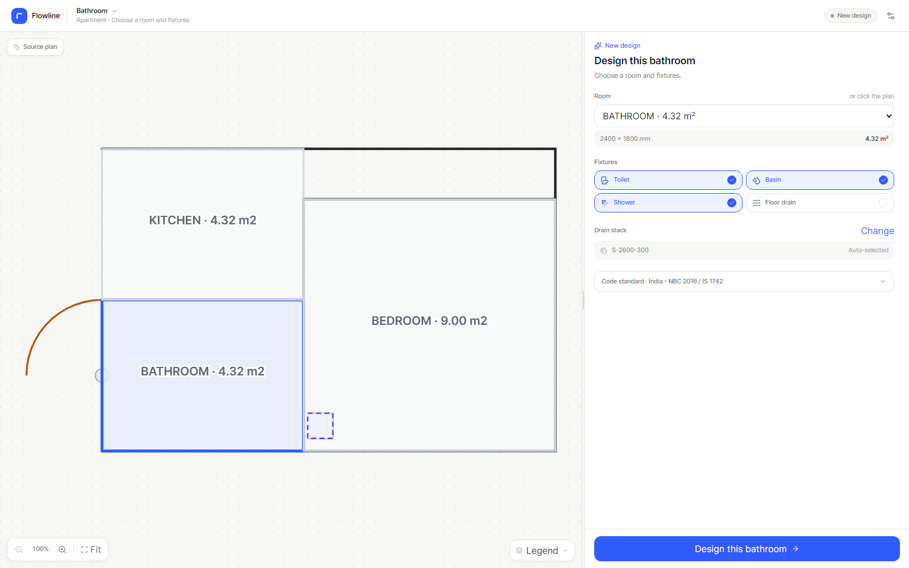
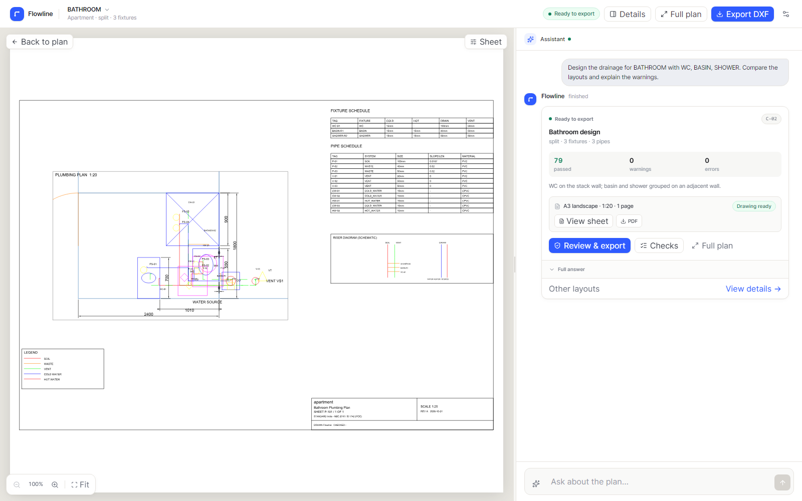
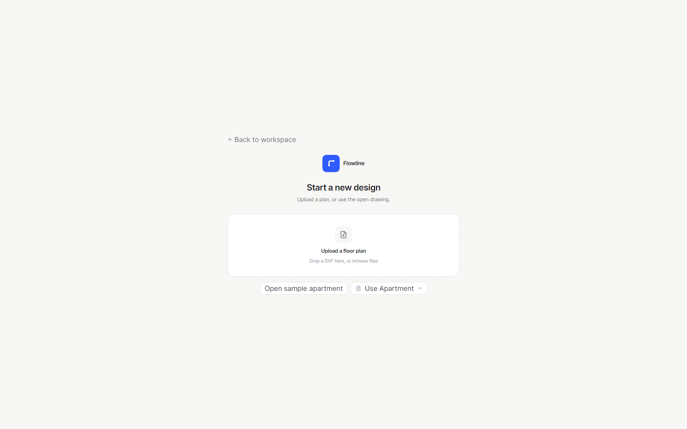

# Flowline

**Agentic floor plumbing design for AutoCAD-native workflows.**

Flowline turns a DXF floor plan into one reviewed floor plumbing design: it detects and selects the plumbing areas, compares room layouts, routes drainage, vent, and hot/cold water to the available stacks, adds equipment and valves, validates against a cited rule pack, reviews the construction sheet, and exports an AutoCAD-ready DXF plus PDF. The workspace is design-first—the plan is the hero, the assistant sits beside it in a resizable panel, and every plan step, agent note, tool call, decision, rejected alternative, and validation result is one click away in Details.








**Hackathon MVP.** Meta Global AI Developer Hackathon, Indie track. New work built during the event. Not a compliance tool.

## What is new

- **Design-first workspace.** The plan fills the canvas with zoom, pan, and a full-screen viewer. Chat sits in a resizable rail, and the setup flow stays out of the way. New Design opens a blank workspace with an upload and the open drawing.
- **Consolidated floor plumbing.** Bathrooms, kitchens, balconies, utility areas, and other plumbing rooms are auto-selected and designed together as one coordinated floor system, while the plan stays clickable for manual inclusion or exclusion.
- **Full plumbing services.** Drainage, fixture vents, hot/cold water, water source/heater, valves, cleanouts, floor-drain trap primer, and schedules across every selected room.
- **Any-size construction sheet.** A4–A0, ANSI A–E, or custom; plan, riser diagram, schedules, legend, notes, blocks, dimensions, and title block. A3 default; automatic continuation sheets.
- **Sheet preview and downloads.** Live SVG sheet preview, drawing checks, and PDF/DXF downloads after approval.
- **MEP-scoped assistant.** Requests outside the plumbing design are refused; the agent does not answer coding, math, or general trivia.
- **Architectural DXF import.** Rooms are inferred from wall geometry when room polylines are absent; door/window gaps are bridged, annotations are cropped from the preview, and door swings render correctly. If the drawing has no shaft, place the stack directly on the plan.
- **Full agent visibility.** The Details drawer holds layout options, rejected alternatives, check citations, fix history, reasoning, and the full tool log.
- **Quick actions.** Compare layouts, run checks, apply the best fix, prepare/review the sheet, explain decisions, and export.
- **Per-design standards.** India NBC/IS + IPC clearances or US IPC; changing the standard marks the design stale until revalidated.
- **JSON persistence.** Designs, messages, events, and audit logs survive server restarts.
- **Deterministic engineering.** The model coordinates; Python owns geometry, pipe sizes, slopes, routing, and rule checks.

## Quick start

```powershell
python -m venv .venv
.venv\Scripts\Activate.ps1
pip install -r requirements.txt
copy .env.example .env
```

Add a provider key to `.env`:

```dotenv
# Preferred: first-party Meta Model API
META_API_KEY=...

# Or OpenCode Go (the $10 subscription, not Console credits)
OPENCODE_PLAN=go
OPENCODE_CLI_AUTH=true
OPENCODE_AUTH_PROVIDER=opencode-go
OPENCODE_MODEL=muse-spark-1.3-contributor

# Or OpenRouter's Meta path
OPENROUTER_API_KEY=...
OPENROUTER_MODEL=meta/muse-spark-1.3
```

Build the React UI once (the built files are served by FastAPI):

```powershell
cd frontend
npm install
npm run build
cd ..
```

Run:

```powershell
python scripts/check_provider.py
python -m uvicorn app.main:app --reload
```

Open <http://127.0.0.1:8000>. The app auto-loads the latest workspace or creates the sample apartment.

For frontend development, run `npm run dev` in `frontend/` (Vite proxies `/api` to port 8000) alongside uvicorn.

## Flow

1. Upload a DXF or open the sample.
2. Choose **New design**. The workspace clears; upload a plan, or use the open drawing.
3. Pick the room, drain stack, fixtures, and standard. Start the design. A live run card shows the agent's progress; the plan and plumbing systems appear in the canvas and the finished turn settles into a compact design summary.
4. Review the sheet in **Sheet** view. Change the sheet size or orientation from the Sheet settings; the preview rebuilds.
5. Ask follow-ups, or use the suggested actions menu to compare layouts, run checks, prepare the sheet, or review the drawing.
6. Open Details for layouts, code checks, drawing review, and the full activity log. Review, approve, and download the DXF/PDF.

## Provider strategy

```text
LLM_PROVIDER=auto (default)
  META_API_KEY or MODEL_API_KEY -> Meta Model API (muse-spark-1.3)
  OPENCODE_API_KEY              -> OpenCode Console or Go
  OPENROUTER_API_KEY            -> OpenRouter, default model meta/muse-spark-1.3
  otherwise                     -> FakeProvider (offline scripted agent)
```

**OpenCode Console vs Go:** Console and Go share a CLI credential but use different endpoints. `OPENCODE_PLAN=console` uses `https://opencode.ai/inference/openai/v1` and bills Console credits. `OPENCODE_PLAN=go` uses `https://opencode.ai/inference/go/openai/v1`, adds the required `x-opencode-session` header, and bills the Go subscription. The Go default is `muse-spark-1.3-contributor`, which requires **Console → Settings → Privacy → Allow paid endpoints that train on request data**; use only non-confidential demo data. Set `OPENCODE_MODEL=glm-5.3-flash` if the toggle is off.

`OPENCODE_CLI_AUTH=true` reads the key from the OpenCode CLI auth file (`~/.local/share/opencode/auth.json`, provider `opencode-go` for the Go plan), so you do not copy it into `.env`. If the key expires, re-run `/connect` in OpenCode or create a fresh key in Console.

## Architecture

```text
React + Vite workspace
  |-- resizable plan canvas + assistant rail
  |-- full-screen plan viewer with zoom, pan, and legend
  |-- sheet view: SVG preview, any-size settings, page navigation
  |-- details drawer: design / checks / activity
  |-- workspace and settings menus, approval dialog
  |
FastAPI + SSE jobs
  |
Agent runner (multi-turn) ---- provider factory
  |                              |-- Meta Model API
  |                              |-- OpenCode Go/Console
  |                              |-- OpenRouter
  |                              |-- Fake
  |
Deterministic tools
  |-- inspect_plan
  |-- list_layout_options
  |-- select_layout
  |-- route_drainage
  |-- route_services (vent + hot/cold water + equipment)
  |-- prepare_sheet
  |-- set_sheet_options
  |-- review_drawing
  |-- validate_design
  |-- apply_fix
  |-- set_fixtures
  |-- compare_layouts
  |-- get_design_state
  |-- explain_design
  |-- export_dxf (approval-gated)
  |
Core engine
  |-- DXF import/export
  |-- units + geometry
  |-- layout generator
  |-- A* drainage/vent/supply router
  |-- cited rule packs
  |-- deterministic fixes
  |-- sheet builder: blocks, dimensions, schedules, room, riser, title block
  |-- SVG/PDF sheet renderer
  |-- drawing review
```

## Persistence

```text
data/workspaces/<workspace_id>/
  workspace.json
  designs/<design_id>/
    design.json
    messages.json
    events.jsonl
    audit.jsonl
    preview.svg
    export.dxf
```

Atomic JSON writes and per-design turn locking. Local single-user persistence; project grouping and a home dashboard are the next phase.

## Standards

The two profiles are `core/rules/profiles/india_nbc_2016.yaml` and `us_ipc_2021.yaml`. They cover a small, cited subset of room minimums, fixture clearances, spacing, shower size, pipe sizes, slopes, stack minimums, vent warnings, and fixture units. See [docs/standards.md](docs/standards.md).

> Flowline is a design assistant. It checks a small, cited rule pack, not the full code. The local authority and a licensed engineer govern the issued design.

## Tests

```powershell
pytest -q
python -m ruff check .
cd frontend; npm run typecheck; npm run build
```

UI smoke test (fresh data + fake provider):

```powershell
$env:LLM_PROVIDER='fake'; $env:FLOWLINE_DATA_DIR="$PWD\out\ui-test-data"
python C:\Users\prath\.config\opencode\skill\webapp-testing\scripts\with_server.py `
  --server "python -m uvicorn app.main:app --host 127.0.0.1 --port 8000" `
  --port 8000 -- python scripts/ui_smoke_v2.py
```

The suite covers units, geometry, DXF import, layout generation, drainage/vent/supply routing, both rule packs, fixes, construction-sheet generation and preview/PDF, drawing review, provider strategy, reasoning parsing, multi-turn chat, decisions, JSON persistence, API, DXF export, and an end-to-end CLI run.

## Layout

```text
frontend/         React + Vite + TypeScript + Tailwind workspace
app/              FastAPI app, JSON storage, SSE jobs, built UI
core/             units, geometry, models, DXF import/export, layout, plumbing, rules, fixes, sheet, SVG
agent/            multi-turn loop, tools, prompt, audit log, provider strategy
scripts/          sample generator, CLI demo, provider check, AutoCAD handoff, UI smoke
samples/          apartment and tight-bathroom DXFs
tests/            unit, integration, API, and E2E tests
docs/             design, standards, demo script, AutoCAD notes, submission notes
```

## Limitations (this pass)

- No home/project grouping or project-level standards yet. The workspace menu has a per-drawing **Designs** list as the seed.
- Standards are per design; changing one requires revalidation.
- Vent and hot/cold water routes are schematic plan routes plus a schematic riser diagram; coordinate ceiling and wall voids. There is no full 3D coordination.
- Supply sizing is a cited POC subset, not a full hydraulic calculation.
- Room detection handles closed room polylines and architectural wall-line/band plans. Door and window gaps are closed for topology, and room labels are matched to enclosed spaces; verify inferred boundaries before issuing.
- Wet-area layout still assumes a rectangular room bounding box. Irregular L-shaped wet rooms need a manual split.
- JSON persistence is local and single-user.
- No manual fixture dragging. The agent can change the fixture set and re-plan.
- POC rule packs, not compliance certificates.
- No DWG write; use AutoCAD to save the exported DXF as DWG.

## Roadmap

1. Home tab + projects with multiple drawings and project-level standards.
2. Manual fixture placement and a richer editing surface.
3. Multi-room/multi-floor plumbing, kitchens, and full hydraulic calculations.
4. PDF/image intake with Muse vision, DWG/ODA, AutoCAD LT/.NET plugin.
5. Revit/IFC, rule-pack authoring, project versions, engineer sign-off, BOQ.

## Hackathon notes

- New public repo; first commit on 2026-10-29, during the event. The older private POC is not a dependency.
- Demo script: [docs/demo-script.md](docs/demo-script.md). Design: [docs/design.md](docs/design.md). Submission: [docs/submission.md](docs/submission.md).
- The live screenshot and recording use `muse-spark-1.3-contributor` through OpenCode Go. The first-party Meta Model API is supported and preferred when `META_API_KEY` is available.

## License

MIT.
