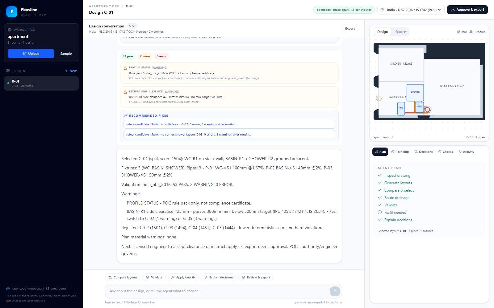

# Flowline

**Agentic bathroom plumbing design for AutoCAD-native workflows.**

Flowline turns a DXF floor plan into a reviewed bathroom drainage design: the agent inspects the plan, compares layouts, routes pipes, validates against a cited rule pack, fixes issues, and exports an AutoCAD-ready DXF. The workspace is chat-first, and every plan step, agent note, tool call, decision, rejected alternative, and validation result is visible.



**Hackathon MVP.** Meta Global AI Developer Hackathon, Indie track. New work built during the event. Not a compliance tool.

## What is new

- **Chat-first workspace.** Conversation, not a form wizard.
- **Full agent visibility.** Plan stepper, provider reasoning, interim agent notes, tool timeline with arguments/results, selected and rejected layouts, fix history, and validation citations.
- **Quick actions.** Compare layouts, validate, apply the best fix, explain decisions, and export.
- **Per-design standards.** India NBC/IS + IPC clearances or US IPC; changing the standard marks the design stale until revalidated.
- **JSON persistence.** Designs, messages, events, and audit logs survive server restarts.
- **Deterministic engineering.** The model coordinates; Python owns geometry, pipe sizes, slopes, routing, and rule checks.

## Quick start

```powershell
python -m venv .venv
.venv\Scripts\Activate.ps1
pip install -r requirements.txt
copy .env.example .env
```

Add a provider key to `.env`:

```dotenv
# Preferred: first-party Meta Model API
META_API_KEY=...

# Or OpenCode Go (the $10 subscription, not Console credits)
OPENCODE_PLAN=go
OPENCODE_CLI_AUTH=true
OPENCODE_AUTH_PROVIDER=opencode-go
OPENCODE_MODEL=muse-spark-1.3-contributor

# Or OpenRouter's Meta path
OPENROUTER_API_KEY=...
OPENROUTER_MODEL=meta/muse-spark-1.3
```

Build the React UI once (the built files are served by FastAPI):

```powershell
cd frontend
npm install
npm run build
cd ..
```

Run:

```powershell
python scripts/check_provider.py
python -m uvicorn app.main:app --reload
```

Open <http://127.0.0.1:8000>. The app auto-loads the latest workspace or creates the sample apartment.

For frontend development, run `npm run dev` in `frontend/` (Vite proxies `/api` to port 8000) alongside uvicorn.

## Flow

1. Upload a DXF or open the sample.
2. Pick the room, stack, fixtures, and standard.
3. Start the design. The chat shows the agent plan, notes, tool activity, candidate comparison, validation, and final answer.
4. Ask follow-ups or use quick actions: compare, validate, apply fix, explain.
5. Review the validation and assumptions, approve, and download the DXF.

## Provider strategy

```text
LLM_PROVIDER=auto (default)
  META_API_KEY or MODEL_API_KEY -> Meta Model API (muse-spark-1.3)
  OPENCODE_API_KEY              -> OpenCode Console or Go
  OPENROUTER_API_KEY            -> OpenRouter, default model meta/muse-spark-1.3
  otherwise                     -> FakeProvider (offline scripted agent)
```

**OpenCode Console vs Go:** Console and Go share a CLI credential but use different endpoints. `OPENCODE_PLAN=console` uses `https://opencode.ai/inference/openai/v1` and bills Console credits. `OPENCODE_PLAN=go` uses `https://opencode.ai/inference/go/openai/v1`, adds the required `x-opencode-session` header, and bills the Go subscription. The Go default is `muse-spark-1.3-contributor`, which requires **Console → Settings → Privacy → Allow paid endpoints that train on request data**; use only non-confidential demo data. Set `OPENCODE_MODEL=glm-5.3-flash` if the toggle is off.

`OPENCODE_CLI_AUTH=true` reads the key from the OpenCode CLI auth file (`~/.local/share/opencode/auth.json`, provider `opencode-go` for the Go plan), so you do not copy it into `.env`. If the key expires, re-run `/connect` in OpenCode or create a fresh key in Console.

## Architecture

```text
React + Vite workspace
  |-- chat, quick actions, plan preview
  |-- mission control: plan / thinking / decisions / checks / activity
  |-- approval dialog
  |
FastAPI + SSE jobs
  |
Agent runner (multi-turn) ---- provider factory
  |                              |-- Meta Model API
  |                              |-- OpenCode Go/Console
  |                              |-- OpenRouter
  |                              |-- Fake
  |
Deterministic tools
  |-- inspect_plan
  |-- list_layout_options
  |-- select_layout
  |-- route_drainage
  |-- validate_design
  |-- apply_fix
  |-- set_fixtures
  |-- compare_layouts
  |-- get_design_state
  |-- explain_design
  |-- export_dxf (approval-gated)
  |
Core engine
  |-- DXF import/export
  |-- units + geometry
  |-- layout generator
  |-- A* router
  |-- cited rule packs
  |-- deterministic fixes
  |-- SVG renderer
```

## Persistence

```text
data/workspaces/<workspace_id>/
  workspace.json
  designs/<design_id>/
    design.json
    messages.json
    events.jsonl
    audit.jsonl
    preview.svg
    export.dxf
```

Atomic JSON writes and per-design turn locking. Local single-user persistence; project grouping and a home dashboard are the next phase.

## Standards

The two profiles are `core/rules/profiles/india_nbc_2016.yaml` and `us_ipc_2021.yaml`. They cover a small, cited subset of room minimums, fixture clearances, spacing, shower size, pipe sizes, slopes, stack minimums, vent warnings, and fixture units. See [docs/standards.md](docs/standards.md).

> Flowline is a design assistant. It checks a small, cited rule pack, not the full code. The local authority and a licensed engineer govern the issued design.

## Tests

```powershell
pytest -q
python -m ruff check .
cd frontend; npm run typecheck; npm run build
```

UI smoke test (fresh data + fake provider):

```powershell
$env:LLM_PROVIDER='fake'; $env:FLOWLINE_DATA_DIR="$PWD\out\ui-test-data"
python C:\Users\prath\.config\opencode\skill\webapp-testing\scripts\with_server.py `
  --server "python -m uvicorn app.main:app --host 127.0.0.1 --port 8000" `
  --port 8000 -- python scripts/ui_smoke_v2.py
```

The suite covers units, geometry, DXF import, layout generation, routing, both rule packs, fixes, provider strategy, reasoning parsing, multi-turn chat, decisions, JSON persistence, API, DXF export, and an end-to-end CLI run.

## Layout

```text
frontend/         React + Vite + TypeScript + Tailwind workspace
app/              FastAPI app, JSON storage, SSE jobs, built UI
core/             units, geometry, models, DXF import/export, layout, router, rules, fixes, SVG
agent/            multi-turn loop, tools, prompt, audit log, provider strategy
scripts/          sample generator, CLI demo, provider check, AutoCAD handoff, UI smoke
samples/          apartment and tight-bathroom DXFs
tests/            unit, integration, API, and E2E tests
docs/             design, standards, demo script, AutoCAD notes, submission notes
```

## Limitations (this pass)

- No home/project grouping or project-level standards yet. The left rail has a per-workspace **Designs** list as the seed.
- Standards are per design; changing one requires revalidation.
- Drainage-only. Water supply and vent geometry are not modeled; long branches are warnings.
- Simple rectangular rooms; the layout uses the bounding box and warns otherwise.
- JSON persistence is local and single-user.
- No manual fixture dragging. The agent can change the fixture set and re-plan.
- POC rule packs, not compliance certificates.
- No DWG write; use AutoCAD to save the exported DXF as DWG.

## Roadmap

1. Home tab + projects with multiple drawings and project-level standards.
2. Manual fixture placement and a richer editing surface.
3. Water supply + vent design, kitchens, multi-room/multi-floor.
4. PDF/image intake with Muse vision, DWG/ODA, AutoCAD LT/.NET plugin.
5. Revit/IFC, rule-pack authoring, project versions, engineer sign-off, BOQ.

## Hackathon notes

- New public repo; first commit on 2026-10-29, during the event. The older private POC is not a dependency.
- Demo script: [docs/demo-script.md](docs/demo-script.md). Design: [docs/design.md](docs/design.md). Submission: [docs/submission.md](docs/submission.md).
- The live screenshot and recording use `muse-spark-1.3-contributor` through OpenCode Go. The first-party Meta Model API is supported and preferred when `META_API_KEY` is available.

## License

MIT.
