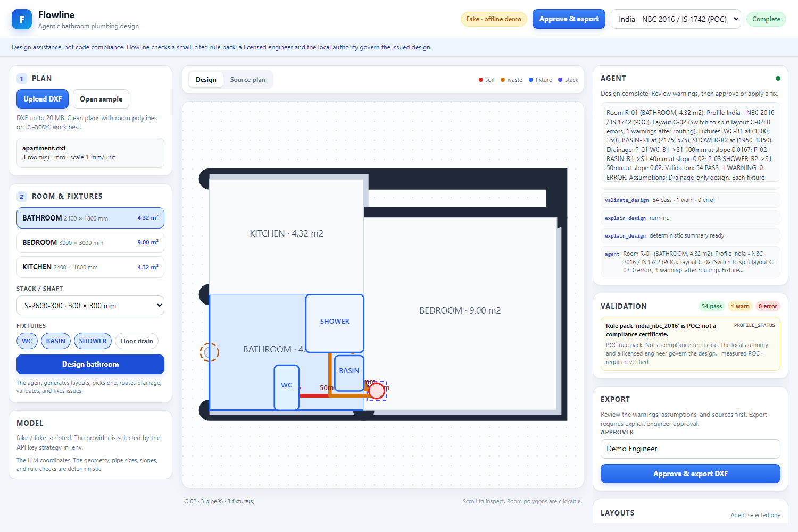

# Flowline

**Agentic bathroom plumbing design for AutoCAD-native workflows.**

Flowline reads a DXF floor plan, generates ranked bathroom drainage layouts, lets a Meta Muse Spark agent choose and explain one, routes the drainage to a stack, validates the result against cited India and US rule packs, applies deterministic fixes, and exports an AutoCAD-ready DXF.

The language model coordinates. The geometry, sizing, routing, and rule checks are deterministic.



**Hackathon MVP.** Meta Global AI Developer Hackathon, Indie track. New work built during the event. Not a compliance tool.

## What it does

1. **Import a real plan.** Read units, closed rooms, door markers, shafts, labels, and background geometry from DXF.
2. **Generate layouts.** The engine produces ranked bathroom layouts (wet wall, split, corner shower, opposite, in-line) with footprint, clearance, door, and stack checks.
3. **Let the agent choose.** Muse Spark inspects the plan, compares candidates, picks one with a short rationale, and never invents a dimension.
4. **Route and size.** Orthogonal A* avoids fixtures and the door swing; pipe sizes and slopes come from the selected rule pack.
5. **Validate with sources.** Every result has a rule ID, measured value, required value, and citation. PASS/WARNING/ERROR counts are shown live.
6. **Fix and revalidate.** Deterministic fixes switch layouts, reroute pipes, or adjust sizes/slopes. The agent applies them one at a time.
7. **Approve and export.** The engineer reviews, approves, and downloads a DXF with `P-*` layers that opens in ordinary AutoCAD.

## Why this is different

- **No LLM math.** Pipe sizes, slopes, geometry, and rule outcomes never come from the model.
- **Rule packs are data.** India (`NBC 2016` / `IS 1742` with IPC clearances) and US (`IPC 2021`) profiles are switchable and cited.
- **Agentic, not a wrapper.** The trace shows inspect → generate → select → route → validate → fix → explain.
- **CAD-native.** DXF in, DXF out. No Revit requirement; no AutoCAD MEP requirement.

## Quick start

```powershell
python -m venv .venv
.venv\Scripts\Activate.ps1
pip install -r requirements.txt
copy .env.example .env
```

Add a Meta Model API key to `.env`:

```dotenv
META_API_KEY=...
META_MODEL=muse-spark-1.3
```

Without a key, the offline fake provider runs the same tool workflow.

```powershell
python scripts/check_provider.py
python scripts/make_sample_plan.py
python scripts/demo_cli.py --provider auto --approve
python -m uvicorn app.main:app --reload
```

Open <http://127.0.0.1:8000>. The app auto-loads a sample apartment. Upload your own DXF or switch to the tight-bathroom sample.

## Provider strategy

```text
LLM_PROVIDER=auto (default)
  META_API_KEY or MODEL_API_KEY -> Meta Model API (muse-spark-1.3)
  OPENCODE_API_KEY              -> OpenCode Console or Go
  OPENROUTER_API_KEY            -> OpenRouter, default model meta/muse-spark-1.3
  otherwise                     -> FakeProvider (offline scripted agent)
```

Explicit `LLM_PROVIDER=meta|opencode|openrouter|fake` overrides auto. An explicit provider without its key fails fast. Keys are never logged or committed.

**OpenCode Console vs Go:** Console and Go share a CLI credential but use different endpoints. `OPENCODE_PLAN=console` uses `https://opencode.ai/inference/openai/v1` and bills Console credits. `OPENCODE_PLAN=go` uses `https://opencode.ai/inference/go/openai/v1`, adds the required `x-opencode-session` header, and bills the Go subscription. The Go default is `muse-spark-1.3-contributor`, which requires **Console → Settings → Privacy → Allow paid endpoints that train on request data**; use only non-confidential demo data. Set `OPENCODE_MODEL=glm-5.3-flash` if you have not enabled that toggle.

`OPENCODE_CLI_AUTH=true` reads the key directly from the OpenCode CLI auth file (`~/.local/share/opencode/auth.json`, provider `opencode-go` by default for the Go plan) so you do not have to copy it. If the key expires, re-run `/connect` in OpenCode or create a fresh key in Console.

## Architecture

```text
Browser (SVG plan, agent trace, validation, approval)
        |
FastAPI + SSE jobs
        |
Agent loop ---- provider factory
        |         |-- MetaProvider
        |         |-- OpenRouterProvider
        |         |-- FakeProvider
        |
Deterministic tools
        |-- inspect_plan
        |-- list_layout_options
        |-- select_layout
        |-- route_drainage
        |-- validate_design
        |-- apply_fix
        |-- explain_design
        |-- export_dxf (approval-gated)
        |
Core engine
        |-- DXF import/export
        |-- geometry + units
        |-- layout generator
        |-- A* router
        |-- cited rule packs
        |-- deterministic fixes
        |-- SVG renderer
```

## Rule packs

`core/rules/profiles/india_nbc_2016.yaml` and `us_ipc_2021.yaml` encode a deliberately small, cited subset: room minimums, fixture clearances, spacing, shower size, pipe sizes, slopes, stack minimums, vent-distance warnings, and fixture units. See [docs/standards.md](docs/standards.md) for values and sources.

> Flowline is a design assistant. It checks a small, cited rule pack, not the full code. The local authority and a licensed engineer govern the issued design.

## Tests

```powershell
pytest -q
python -m compileall app core agent scripts
```

The suite covers units, geometry, DXF import, layout generation, routing, both rule packs, fixes, provider strategy, Meta/OpenRouter payload parsing, agent tools/loop, API, DXF export, and an end-to-end CLI run.

UI smoke test (starts the app on port 8000):

```powershell
python C:\Users\prath\.config\opencode\skill\webapp-testing\scripts\with_server.py `
  --server "python -m uvicorn app.main:app --host 127.0.0.1 --port 8000" `
  --port 8000 -- python scripts/ui_smoke.py
```

## Layout

```text
app/              FastAPI app, SSE jobs, static UI
core/             units, geometry, models, DXF import/export, layout, router, rules, fixes, SVG
agent/            tools, prompt, loop, audit log, provider strategy
scripts/          sample generator, CLI demo, provider check, AutoCAD handoff, UI smoke
samples/          apartment and tight-bathroom DXFs
tests/            unit, integration, API, and E2E tests
docs/             design, standards, demo script, AutoCAD notes, plan
```

## Limitations (v1)

- Drainage-only. Water supply and vent piping are not modeled; long branches are warnings.
- Simple rectangular rooms. The layout uses the room bounding box and warns on non-rectangular rooms.
- Clean DXF plans. Legacy polylines, xrefs, and heavily blocked plans need hardening.
- POC rule packs, not compliance certificates.
- No DWG write. Use AutoCAD to save the exported DXF as DWG.
- Live AutoCAD is a separate script, not part of the web server.

## Roadmap

1. Water supply + vent design, kitchen and multi-room layouts.
2. PDF/image intake using Muse vision, with human confirmation.
3. DWG/ODA, AutoCAD LT file-IPC or .NET plugin, then Revit/IFC.
4. Rule-pack authoring, project versions, engineer sign-off, BOQ.
5. Per-seat SaaS + metered drawing automation for small MEP firms.

## Hackathon notes

- New public repo; first commit on 2026-10-29, during the event. The older private POC is not a dependency.
- 3-minute demo script: [docs/demo-script.md](docs/demo-script.md).
- Design: [docs/design.md](docs/design.md). AutoCAD: [docs/autocad.md](docs/autocad.md).
- Meta Model API is the primary provider. OpenCode Console/Go and OpenRouter are fallback gateways that expose `muse-spark-1.3`; OpenRouter defaults to `meta/muse-spark-1.3`. The fake provider is for tests and offline demos.

## License

MIT.
